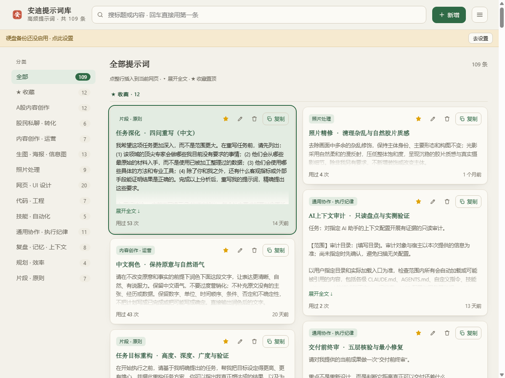

# 安迪提示词库 · Chrome 扩展

一个**本地优先**的个人提示词库：在任意网页输入框行首打 `//` 搜索并插入；`Alt+P` 打开侧边栏；`{{变量}}` 填空；`Ctrl+S` 存草稿；插入后 6 秒内可撤销。数据保存在 Chrome 本地，不上传；可选把整库备份到本机硬盘。

**当前版本：v1.1.5** · Chrome 116+ · Manifest V3

## 功能

- **网页内 `//` 唤起**：行首/空格后输入 `//`（中文输入法 `、、`、全角 `／／` 也行），搜索、`↑↓` 选择、`Enter` 插入；每行带正文摘要和分类。
- **侧边栏**：`Alt+P` 或点工具栏图标；卡片/紧凑两种视图；分类、收藏筛选、按使用频率排序；搜索框 `↑↓` 高亮 + `Enter` 插入。
- **`{{变量}}` 填空**：如 `{{股票名}}`、`{{周期:近一周}}`；纯数字名按字面量保留（`{{16:9}}` 不会被误当变量）。
- **保存**：网页 `Ctrl+S` 存为待保存草稿（图标显示绿色数字）；`Alt+P` 打开侧边栏确认；右键选中文字也可保存。
- **插入撤销**：网页浮层和侧边栏插入后都有 6 秒「撤销」，恢复原内容并回滚使用次数。
- **导入 JSON**：先预览「将导入 N / 跳过重复 M / 忽略无效 K」，确认后才合并；支持导出备份。
- **可选硬盘备份**：由本机 Python 小助手写 `最新.json`、每日存档、条数骤降留底；多 Chrome Profile 分目录；待导入文件合并成功后才移走。

## 安装

### A. 只用扩展（推荐先这样）

1. 到 [Releases](https://github.com/ady220104-spec/andy-prompt-library/releases) 下载 `andy-prompts-v1.1.5.zip`，解压到一个固定目录。
2. Chrome 打开 `chrome://extensions` → 开启右上角「开发者模式」→「加载已解压的扩展程序」→ 选解压后的目录。
3. 拼图图标里把「安迪提示词库」固定；点图标或 `Alt+P` 打开侧边栏。

> 这个 zip 只含扩展运行时文件；不装本机助手时侧边栏显示「备份未启用」，不影响使用。

### B. 需要自动硬盘备份

备份助手需要 Python 3，并且要放在扩展目录里才能自动识别扩展 ID：

1. 下载本仓库（`Code` → `Download ZIP`，或 `git clone`），或下载 Release 里的 `andy-prompts-v1.1.5-full.zip`（已含本机助手），解压到固定目录。
2. `chrome://extensions` →「加载已解压的扩展程序」→ 选 `安迪提示词库-插件` 文件夹（full 包解压后就是该文件夹）。
3. 在这个文件夹里双击 `修复备份.cmd`（或右键 `backup-host\登记备份助手.ps1` →「使用 PowerShell 运行」）。脚本会按当前目录自动推导扩展 ID，逐项打印 PASS/FAIL。
4. 刷新扩展 → 关掉重开侧边栏 → 右键工具栏图标「重新备份提示词库到硬盘」。

默认备份目录是插件文件夹上一级的 `安迪提示词库-备份`；可在登记时用 `-BackupDir` 指定。详见 [安装说明](安迪提示词库-插件/安装说明.md)。

## 使用速览

| 操作 | 方式 |
|---|---|
| 网页里选提示词 | 输入框行首 `//` + 关键词 → `↑↓` → `Enter` |
| 打开侧边栏 | `Alt+P` / 工具栏图标 |
| 存草稿 | 网页输入框 `Ctrl+S` → 按 `Alt+P` 确认 |
| 填空 | 选择含 `{{变量}}` 的提示词，按提示填写 |
| 撤销插入 | 插入后 6 秒内点 toast 的「撤销」 |
| 只看收藏 | 侧边栏分类选「★ 收藏」 |
| 导入/导出 | 侧边栏 ≡ → 导入 JSON / 导出 JSON |
| 外观 | 侧边栏 ≡ → 外观：跟随系统 / 浅色 / 深色 |

## 数据与隐私

- 提示词保存在 `chrome.storage.local`，不上传、不联网。
- 唯一的外写是本机硬盘备份：由你安装的 Python 助手写到你自己指定的目录，不经过服务器。
- 完整说明见 [PRIVACY.md](安迪提示词库-插件/PRIVACY.md)。

## 权限

`storage` / `unlimitedStorage`（存库）、`sidePanel`（侧边栏）、`scripting`（插入、右键读取选中文字）、`contextMenus`（右键保存/重试备份）、`clipboardWrite`（无输入框时复制）、`nativeMessaging`（仅可选硬盘备份）、`host_permissions: http/https`（`//` 唤起与插入）。没有远程代码、没有统计、没有上传。

## 开发 / 打包

- 扩展源码在 [`安迪提示词库-插件/`](安迪提示词库-插件/)，直接加载该目录即可调试。
- 干净发布包：在该目录运行 `build-release.ps1`，输出到 `dist/andy-prompts-v<版本>.zip`（只含运行时文件，排除 backup-host、文档、测试）。
- 本机备份助手：`安迪提示词库-插件/backup-host/` + `修复备份.cmd`，协议 v2（待导入两阶段确认、多 Profile 分目录）。
- 版本记录见 [CHANGELOG.md](CHANGELOG.md)。

## 说明

- 当前不是 Chrome Web Store 上架版本：本机备份助手无法随商店包安装，所以采用「GitHub + 未打包扩展 + 可选本机助手」的发布方式。
- 许可证：[MIT](LICENSE)（覆盖代码；`seed.json` 内置提示词内容的版权归作者）。
